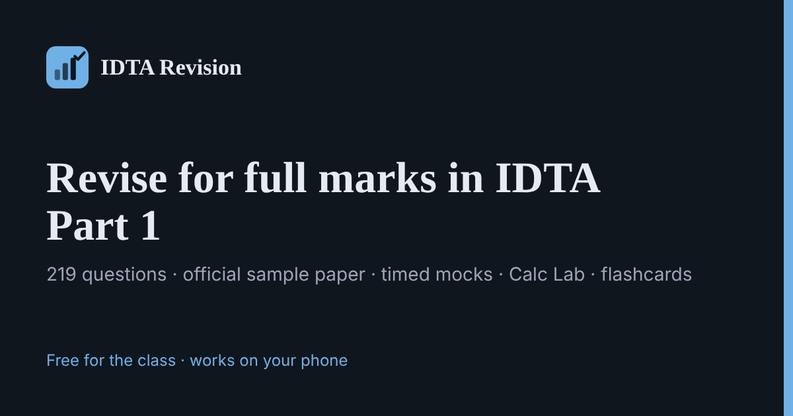

# IDTA Exam Revision

A free study app with two parts:

- **AI & Machine Learning course**, open to students at any university: 26 in-depth lessons in 8 units, from statistics and the maths of learning to transformers, generative AI and MLOps, with 100+ exam-style questions, a course exam, Calc Lab and flashcards.
- **University of Portsmouth IDTA Part 1 pack**, for verified Portsmouth students only (@myport.ac.uk email check): all 219 module questions (the official sample paper plus every other question, organised topic by topic in lecture order), module notes and an exam-format mock (30 questions, 60 minutes, closed book, no calculator).

**▶ Open the app: https://ajinkyarodge66.github.io/idta-revision/**

It works on phones and laptops, and offline once it has loaded. On your phone, use **Add to Home Screen** to install it like an app.

## Features

| Tab | What you get |
|---|---|
| **Learn** | The 26-lesson AI & ML course, each lesson with worked examples, code, key takeaways and a quick check |
| **My university** | Verify your university email to unlock your private module pack (University of Portsmouth IDTA: notes, sample paper, practice by syllabus topic, module mock) |
| **Must-know** | 61 one-line facts to tick off as you memorise them |
| **Practice** | 100+ course questions (single answer, multiple response, matching) with instant explanations. **My mistakes** keeps every wrong answer until you get it right. Verified Portsmouth students also get all 219 module questions, including the 25 official sample-paper questions |
| **Calc Lab** | Unlimited fresh calculation questions with worked solutions: confusion-matrix metrics, min-max, distances, support/confidence/lift, Gini, Naïve Bayes, k-means centroids, linkage, mean/median/mode, IQR fences, MAE/MSE/RMSE, binning, weighted mean |
| **Mock exam** | Full (30 questions / 60 min) or quick (10 questions / 20 min) mocks, with flags, auto-submit, per-topic breakdown and keyboard shortcuts. The course exam unlocks with a code (£3); verified students' university module exam is free |
| **Flashcards** | 65 flip cards, filterable by topic |
| **Progress** | Readiness score, accuracy by topic, coverage of the question bank, and mock score history |
| **Leaderboard** | Class leaderboard (best mock score, questions answered, accuracy) and "where the class struggles" by topic |
| **Account** | Edit your details, change password, log out, delete account |
| **Admin** (organiser only) | Class overview, **exam coupon codes** and access grants, **announcements** banner, **add/edit your own questions**, hide built-in questions, **CSV export** |

Topics: data & statistics, similarity & distance, data preparation, classification (decision trees, Naïve Bayes, SVM), evaluation, neural networks & deep learning, ensembles, regression, association rules (Apriori), clustering, and Python/lab code.

## Accounts & privacy

Students sign up with their **name, mobile number, email, university, course and a password**, then log in with **mobile number + password**. Progress (answers, mistakes, mock history, must-know ticks) is backed up to the account and restored on any device. Forgot your password? A 6-digit reset code is emailed to you.

Details are stored in a private Google Sheet run by the group organiser and used only to run the app: logins, progress backup, reset codes, the leaderboard (name, course and scores, only if you opt in) and showing which topics the class finds hard. Passwords are never stored or sent in readable form. You can hide yourself from the leaderboard or **delete your account and all its data** in the Account tab.

Organisers: see [`backend/SETUP.md`](backend/SETUP.md). For your own web address, see [`DOMAIN.md`](DOMAIN.md).

## Suggested plan

1. Read the cheat sheet once.
2. Portsmouth students: answer the 25 official sample-paper questions, then work through **Practise by syllabus topic** in My university.
3. Take a full mock exam.
4. Drill your weakest topics (the Progress tab shows them) and do 10 Calc Lab questions a day.
5. Clear **My mistakes** to zero and tick every line in **Must-know**.
6. Repeat full mocks until you score 28/30 or more twice.

## Found a mistake?

[Open an issue](https://github.com/Ajinkyarodge66/idta-revision/issues) with the question text and what you think the right answer is.

## Disclaimer

This is an unofficial, student-made revision tool. It isn't affiliated with or endorsed by the university. Content is summarised from the module's lectures and labs; always check against your own notes.

## Run locally

Download the repository and open `index.html` in any browser. No install is needed.
